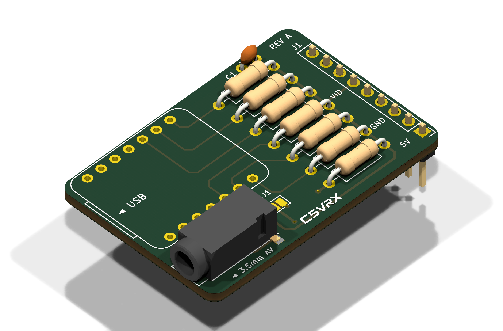
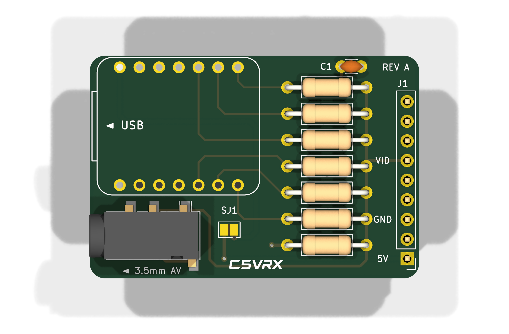
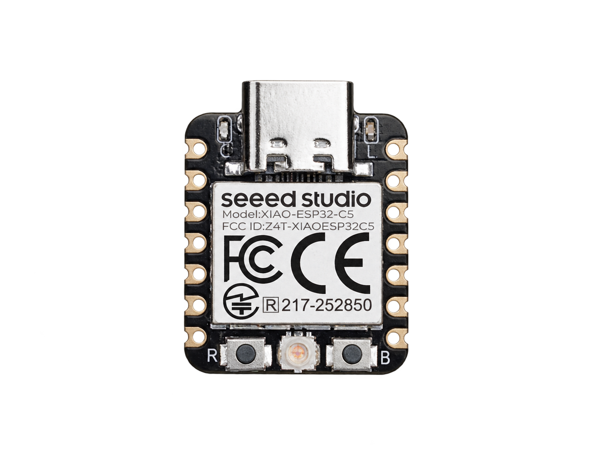
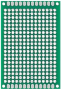
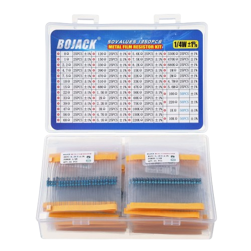

<div align="center">
  

  <p><strong>ESP32-C5 Analog 5.8 GHz FPV Receiver</strong></p>
  <p>From live 5.8 GHz FPV video to real-time analog CVBS with one Seeed Studio XIAO ESP32-C5 and a passive resistor DAC.</p>

  <p>
    <a href="https://twotoz.github.io/C5VRX/"></a>
    <a href="https://discord.gg/3YNgJRHmzD"></a>
    <a href="https://www.youtube.com/watch?v=Gp3xmLrn_34"></a>
    
    
    
    
    
  </p>

  <p>
    
    
  </p>
</div>

---

C5VRX-5 receives analog 5.8 GHz FPV video using the ESP32-C5's own radio
and outputs composite PAL/NTSC through a passive 6-bit resistor DAC.
It includes automatic gain control, startup calibration, an on-screen menu
and browser-based flashing and controls. The sync flywheel was removed on
2026-10-25 (it caused severe desyncs and poor range on the board).

This branch builds and boots **U80P64-R1 only**. U85Q, kp/LP switching and
`m/K/k/j/P/O/H` controls are retired; see [P64 integration and evidence](docs/P64.md).
The fixed R1 table has one positive NTSC observation; PAL, weak-signal/range
and the final cleanup still need hardware validation. This default is an
operator choice, not a hardware qualification claim.

The PR #254 **11p receive baseline** is now applied at startup and after
channel/bandwidth/AFC restores, before measured analog profiles and digital
mode 0. Upgrading discards earlier RF calibrations; let startup calibration
finish (VTX off is best). The noise-only bench result is not a measured
sensitivity/range gain; see [11p integration and limits](docs/FINDINGS.md#11p-receive-baseline-pr-254-integration-2026-10-24).

## Experimental firmware — flight safety warning

> [!WARNING]
> **C5VRX is an experimental FPV receiver. Bugs, signal loss, automatic
> receive-chain changes or incompatibility with your camera/goggles can cause
> sudden loss of video or sync, even after an apparently successful test.
> Loss of FPV video can lead to a crash, property damage or serious injury.**
> Do not rely on C5VRX as your only means of maintaining safe control of an aircraft.

- **Test every new firmware version and hardware/settings combination on the
  ground first.** Remove propellers for bench tests. Check startup and
  calibration, weak-signal behaviour, recovery after video loss, and your actual
  camera/goggles. Complete calibration before takeoff.
- **Keep disruptive controls on the ground:** calibration, scanning, channel
  changes, menu entry/exit, DAC tests and diagnostics can interrupt or replace
  the live picture. Do not flash firmware or run bench tests during flight.
- **Automatic changes are experimental too.** Live filter/profile switching is
  currently documented as enabled by default and awaiting board validation.
  It restarts part of the receive chain and may interrupt video. Console
  `A` disables live profile switching (report-only mode); confirm the state
  with `T` on your build. Live OUTPUT, format and profile changes restart the pipeline. These settings do not establish flight safety.
- If you proceed to flight testing, use a controlled area clear of people,
  traffic and property, keep the aircraft close, and have a safe way to recover
  control if video disappears. Follow applicable local rules, including visual
  line-of-sight and observer requirements.
- **A versioned release, a “Latest” label or passing CI is not flight
  qualification.** Unmerged PR builds are development builds. Check the exact
  build's documented hardware and flight-test evidence; a test of an earlier
  build does not validate later changes.
- Report unexpected video loss with the exact firmware version/commit, hardware,
  settings, reproduction steps and any available logs/DVR footage. Preserve
  evidence after an incident, and investigate on the ground before flying again.

The firmware is provided under [GPL-3.0-only](LICENSE), including its warranty
and liability provisions in sections 15–17, to the extent permitted by
applicable law. This warning does not replace those terms or limit rights
that cannot legally be excluded.

## Video

[Watch the C5VRX-5 vs C5VRX-4 flight range test by Louis Hitchcock](https://www.youtube.com/watch?v=Gp3xmLrn_34).

## Hardware

XIAO ESP32-C5. DAC on D4..D9 (GPIO 23, 24, 11, 12, 8, 9; LSB first) with
8.2k / 3.9k / 2k / 1k / 470R / 240R and a 200R load, as in C5VRX-3/4
([schematic](docs/hardware/c5vrx-dac-schematic.png)). The
receiver uses the ESP32-C5's own Wi-Fi radio; no extra RF parts.

### Wiring the resistor DAC

Six resistors, one per XIAO pin, all joined on one node: that node is the
video output (CVBS). A seventh resistor from that node to GND is the load.

| XIAO pin | GPIO | DAC bit | resistor to the output node |
| --- | ---: | --- | ---: |
| D4 | 23 | bit 0 (LSB) | 8.2 kΩ |
| D5 | 24 | bit 1 | 3.9 kΩ |
| D6 | 11 | bit 2 | 2.0 kΩ |
| D7 | 12 | bit 3 | 1.0 kΩ |
| D8 | 8 | bit 4 | 470 Ω |
| D9 | 9 | bit 5 (MSB) | 240 Ω |
| GND | - | load | 200 Ω (output node to GND) |

```
D4 --[8.2k]--+
D5 --[3.9k]--+
D6 --[2.0k]--+
D7 --[1.0k]--+-----------> CVBS out (goggle / monitor AV-in, video)
D8 --[470R]--+     |
D9 --[240R]--+   [200R]   (optional: 470 pF from the node to GND,
                   |        improvement unproven)
GND ---------------+------> GND (goggle / monitor AV-in ground)
```

- The pin order matters: the largest resistor (8.2k) goes on D4 and the
  smallest (240R) on D9. A swapped pair gives a scrambled, banded picture.
- Connect the output node to the video input (centre/tip) of the goggles,
  a DVR or an analog monitor, and the XIAO GND to its ground. A common
  ground is required.
- All values are standard E24; 1 % metal-film resistors are fine. Keep
  the wires from the pins to the node short.
- OUTPUT defaults to AUTO: standard CVBS levels (~0.28 V sync, ~1 V sync to
  white into 75 ohm) set from the measured VTX sync, which strict digital
  goggles such as HDZero need. Manual 0.5-5.0x stays in the menu (saved).
- The XIAO is powered over USB-C or its 5 V pin as usual; the DAC needs no
  separate supply.
- **Check the build with the DAC self-test** before chasing picture
  problems: a test pattern for the goggles and a multimeter check that names
  a swapped, open or wrong resistor. See
  [Building and testing the resistor DAC](docs/hardware/dac-build-and-test.md).

### DIY Carrier PCB: Fat Shark Module + 3.5 mm AV Jack

If you prefer a clean PCB over perfboard, the open-source **[C5VRX_JACK_DIY](hardware/C5VRX_JACK_DIY)** carrier board is designed to drop directly into standard Fat Shark goggle bays while also including a 3.5 mm TRRS AV jack for universal bench testing and standalone monitor hookup.

Getting the PCB manufactured (via JLCPCB, PCBWay, etc.) is extremely inexpensive—often even cheaper than buying a sheet of perfboard—and only requires soldering standard through-hole ¼W resistors and pin headers!

<div align="center">
  
  
</div>

| Feature | Details | Benefit |
| --- | --- | --- |
| **Form factor** | 42.51 × 28.80 mm (r = 2.0 mm) | Fits standard Fat Shark Dominator module bays |
| **AV output** | 3.5 mm TRRS jack (PJ-320D) + Bay Pin 1 | Universal: use in goggles, on external monitors, or for bench testing |
| **Through-hole DAC** | Standard ¼W axial resistors (`DIN0207`) | Quick hand-soldering with labeled footprints (`8.2k`, `3.9k`, etc.) |
| **Socketed MCU** | 2× 7-pin female pin headers | Reusable Seeed XIAO ESP32-C5 with USB-C accessible on the edge |
| **Dual power** | 5V goggle rail (via SJ1 solder bridge) or USB-C | Powered from the goggles or directly via USB for bench testing |
| **Fabrication files** | Gerber zip, Excellon drill, BOM, STEP/GLB | Ready to order immediately from [`hardware/C5VRX_JACK_DIY`](hardware/C5VRX_JACK_DIY) |

## Flashing

- **Browser:** open the [web flasher](https://twotoz.github.io/C5VRX/) in
  desktop Chrome or Edge, choose **C5VRX-5** and a build, then flash.
  Use **Full firmware** when switching from another generation.
  Unmerged PR builds are marked as development builds.
- **From source:** use ESP-IDF **6.0.2** and run `idf.py build flash` in
  the repository root. Filter and DC correction require its exact libphy;
  other PHY versions disable them and produce a build warning.
- **Local File** flashes your own `.bin`; **Legacy builds** contains archived
  C5VRX-3 firmware.

## First boot

1. Power the receiver with the **VTX off** and let calibration finish.
   The goggles show progress; the first run can take up to eight minutes.
   Results are stored, so later boots skip completed measurements.
   A firmware update may require a fresh calibration.
2. Turn on the VTX and select its channel or use SCAN. Without a stored
   channel, the receiver starts on A1 (5865 MHz).

## Controls (BOOT button)

| Action | Live video | Menu |
| --- | --- | --- |
| Short press | Next channel | Next item |
| Hold 0.6 s | Open menu | Select item |

The menu provides **BAND**, **CHANNEL**, **SCAN**, **VIDEO** (AUTO/NTSC/PAL),
**CALIBRATE**, **OUTPUT** (AUTO default, or 0.5-5.0x), **GAIN** (AUTO/MAX/fixed),
**DAC TEST** and **EXIT**. It closes after 30 seconds of
inactivity, or five minutes in DAC TEST. Menu transitions can interrupt video.
GAIN starts in AUTO on every boot.

## Serial console (USB, 115200)

Use the web flasher's **Terminal** tab for receiver controls and logs,
or a serial terminal at 115200 baud. Keys are case-sensitive and sent
without Enter; `h` lists the commands supported by your firmware.

| Key | Action |
| --- | --- |
| `T` / `h` | Status / help |
| `b` / `c` / `s` | Next band / next channel / scan |
| `o` / `n` / `x` / `e` | Open menu / next item / select / exit |
| `v` / `g` / `G` | Video standard / output level / gain |
| `F` / `Z` | Recalibrate / DAC self-test (ground only) |
| `D` / `R` | Health report / per-second field diagnostics |
| `I` / `M` / `L` | IQ snapshot / gain map / bench IQ lane test |
| `A` | Live analog filter/profile switching on/off (saved) |
| `` ` `` | USB download mode |

P64 always uses the same fixed program and LUT. Profiles select only the
analog filter (DEFAULT, NARROW or WIDE); old `kp_auto` and `lp_cn` settings
are ignored. `A` toggles experimental live profile switching (default on).
Live OUTPUT and profile changes share a five-second
cooldown and verified halted restart/rollback. Higher OUTPUT levels can clip.
GAIN always starts AUTO at boot; the OUTPUT preference is saved (default AUTO).
Check `T` after changing settings. Retired models remain research only.

The browser terminal and flasher use the port one at a time. **Download log**
saves the displayed output; only the latest 120,000 characters are retained.

## Documentation and development

- [DAC build and self-test guide](docs/hardware/dac-build-and-test.md)
- [C5VRX_JACK_DIY Fat Shark carrier PCB](hardware/C5VRX_JACK_DIY)
- [Receiver findings and hardware evidence](docs/FINDINGS.md)
- [Field-test protocol](docs/FIELD_TEST.md)
- [Current receiver changes and validation](docs/PR212.md)
- [U85Q research](docs/pr190-key-findings.md) and [research index](research/README.md)
- [Contributing](CONTRIBUTING.md)

`main/` contains C5VRX-5 firmware, `web/` the GitHub Pages flasher,
`test/` host tests, `docs/` guides and findings, `research/` experiments,
and `tools/` console and CI helpers. `legacy/` preserves C5VRX-1 through
C5VRX-4 as reference; they are not built.

CI runs host/research checks and builds firmware with ESP-IDF 6.0.2.
Firmware changes publish versioned `c5vrx5-v5.0.N` releases or unmerged
`c5vrx5-pr-N` builds. Website-only changes do not create firmware releases.
Pages deploys the website from `main` with a same-origin firmware mirror.
Firmware PRs need passing checks and board tests on the matching artifact;
host tests alone do not establish picture compatibility or RF range.

## Community

Share build photos, questions and feedback on the
[C5VRX Discord](https://discord.gg/3YNgJRHmzD).

## Credits and license

C5VRX-5 is part of [C5VRX](https://github.com/Twotoz/C5VRX) by Twotoz and
the C5VRX contributors; the official website
([twotoz.github.io/C5VRX](https://twotoz.github.io/C5VRX/)) has the project
and its Discord invite. It builds on C5VRX-2..4 (the continuous MODEM_DIAG
to BitScrambler video path, Direct Gain V3-V5, the PAIR schedule and the
U85Q study of PR #190), on zerowidth/C5VRX PR #3 (interference-burst gate,
sampling-phase probe, off-grid channel tuning), on Louis Hitchcock's staged
overload recovery (C5VRX #182/#184), and on ESPARGOS esp-sdr (GPL-3.0) for
the C5 RX filter control. Espressif supplied the GDMA EOF fix
(espressif/esp-idf#19091).

Like the rest of this repository, C5VRX-5 is licensed under
**GPL-3.0-only** (see [LICENSE](LICENSE)). The GPL allows
commercial use, including selling receivers with this firmware, provided
the source (with your changes) is passed on under the same license.

The C5VRX name and logos have separate terms; see [assets/BRANDING.md](assets/BRANDING.md).

## Build components

| Product | Photo | Link / Source |
| --- | --- | --- |
| Seeed Studio XIAO ESP32-C5 |  | [View on Amazon](https://link.amazon/B0gopCVDt) |
| C5VRX_JACK_DIY Carrier PCB |  | [Gerbers & KiCad files](hardware/C5VRX_JACK_DIY) (often cheaper than perfboard!) |
| Perfboard (alternative) |  | [View on Amazon](https://link.amazon/B0i2qqMeq) |
| Resistor kit |  | [View on Amazon](https://link.amazon/B06XSBkln) |

Affiliate links. As an Amazon Associate, I earn from qualifying purchases.
All affiliate earnings go back into C5VRX development.

