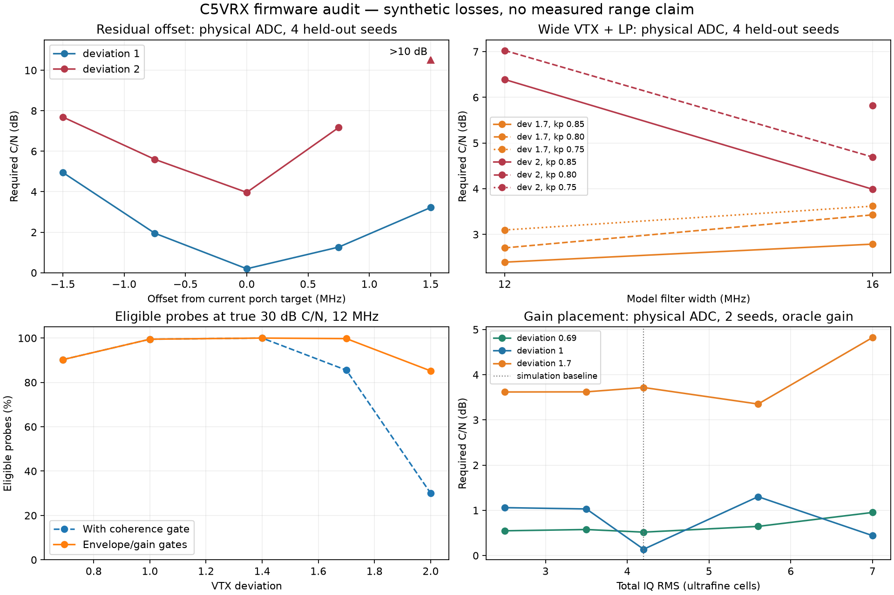

# Firmware range audit after PR 211

C5VRX by Twotoz and the C5VRX contributors. This investigation extends the
root range simulations, field-walk research and the archived PRE-Q4/gain
work; it is not an independent rediscovery of those methods.

Baseline: main `14e190d9` / release `c5vrx5-v5.0.109`, including PR 211.
The operator's first picture impression after flashing PR 211 was positive
("lijkt vrij fantastisch"). No controlled attenuation or distance gain was
measured in that check.

## Investigation boundary

Keep the continuous hardware sample path and the verified restart contract.
Separate measured board symptoms, code defects, synthetic comparisons and
changes that still need a hardware A/B. Do not add model dB gains together:
many address the same loss and the actual receiver may already avoid it.

## Leads from the baseline

- The first captured status after flashing `ee46420` had G83 and physical
  U85Q-LP, but `copy_fail=55` of 192 control ticks and `obs_us_max=1176`.
  Scheduler suspension did not establish near-zero copy failures. These
  were startup observations, not a controlled steady-state timing test.
- The same status said `lp_release_hold_ms=0`, although the policy reset
  sets a 2 s base hold. Audit the real static initialization, not only the
  reset-based host fixtures.
- `profile_observe` still requires phase coherence >=80 in addition to
  envelope C/N. This can reject a real FM carrier because of its waveform,
  and prevent the measured deviation from unlocking matched range curves.
- Every 64-byte high-priority sentinel window computes envelope moments,
  even though the sentinel only needs clipping/gain evidence. Every normal
  gain window also computes C/N at gain-observer cadence, far above the
  50 ms control cadence. Audit unnecessary work and stale measurement use.
- AFC loss, missed observations and locked-state re-acquisition have
  separate reset rules. Audit whether missing evidence can still erase a
  good centre estimate or leave the receiver off-centre at the edge.
- Filter/deviation mismatch, residual offset, gain/quantisation placement,
  sampling phase and DC already have synthetic loss evidence in the older
  research. Re-score relevant cases against the current U85Q-LP ladder,
  rather than treating fixed U85Q as today's baseline.

## Reproduced defects and fixes

- **B/W AFC:** pass two discarded every candidate lacking a burst before
  pass three could check line timing. Keep shape-confirmed candidates and
  require correctly spaced same-polarity syncs. A lone unconfirmed sync
  stays rejected. The raw-IQ fixture fails 9/19 checks on baseline `14e190d9`
  and passes all 19 now: PAL/NTSC, both polarities, colour/B/W, fast picture,
  wrong period and 64 independent noise windows.
- **Fade recovery:** four missed windows lose native lock, where a full
  AFC reset bypassed the 20-miss grace. Reacquisition now clears correction
  budgets while preserving estimates/sign validation. Contradictory
  standard/polarity, context changes and >20 misses still invalidate them.
  New correction requires fresh valid sync and strong envelope C/N; remove
  the redundant picture-dependent phase-coherence prerequisite.
- **Fast FM:** gain HOLD and profile/carrier-DC eligibility retained phase
  coherence gates. Gain HOLD now uses amplitude/clip/origin evidence;
  profile retains settled gain, p50, no clipping, envelope C/N and consistent
  sync/deviation. DC retains actual circle/envelope validation; gain-map
  safeguards remain. A quantized 7.5 MHz FM fixture reaches HOLD with zero
  unnecessary gain writes and is eligible for profile measurement.
- **Short RX tail:** the ring contains eight 4092-byte descriptors and one
  32-byte tail. Select the newest sufficiently long completed source and
  calculate exact pointer/time margins. Elapsed-time rejection detects a
  complete lap that modulo pointers miss. Observer/sentinel share the proof.
  151 checks cover every active node, tail skip and overwrite/wrap rejection.
  Exclusive `CONTROL_COPY` failure counters expose remaining board causes.
- **LP startup:** explicitly reset the static ladder and seed verified
  transport; the release hold previously began at zero. Enter LP at G70,
  release only below G65 after the adaptive hold.
- **Sentinel work:** `dg_measure_gain` omits unused envelope moments for
  64-byte emergency probes. The observer retains full C/N measurement;
  paired random/correlated fixtures verify identical gain evidence.

## Synthetic loss budget with actual LP policy

Export C targets from the actual firmware header and use existing bit-exact
U85Q-LP. Assume LP active, true C/N supplied to policy, fixed scene gain and
no controller delay. This estimates avoidable configuration loss, not actual
closed-loop improvement. Threshold is the worse of luma SINAD 0 dB and 90%
displayed-line lock, interpolated across input C/N. It is not distance,
measured sensitivity or an affected-LCD acquisition threshold.

Held-out runs use four seeds (two PAL, two NTSC), one field per case,
physical ADC saturation/ultrafine folding and one noisy-total RMS gain shared
with the clean reference. Exploratory profile/offset runs use two seeds and
older normalization; their quantizer sweep explicitly uses physical ADC.

| Held-out condition | Required input C/N | Paired loss |
| --- | ---: | ---: |
| Deviation 1.0, matched 10 MHz, centered | 0.20 dB | baseline |
| Same, offset +0.75 / -0.75 MHz | 1.27 / 1.95 dB | 1.07 / 1.75 dB |
| Same, offset +1.5 / -1.5 MHz | 3.22 / 4.95 dB | 3.02 / 4.75 dB |
| Deviation 2.0, 16 MHz LP kp 0.85 | 3.99 dB | matched baseline |
| Same deviation, 12 MHz LP kp 0.80 | 7.03 dB | 3.04 dB |
| Deviation 1.7, 16 MHz kp 0.85 / 12 MHz kp 0.80 | 2.79 / 2.70 dB | effectively tied |

Do not add overlapping filter/offset losses. Deviation 2.0 with +1.5 MHz
offset fails to reach the luma threshold within 10 dB input: a censored,
distorted-output result, not an exact sensitivity penalty. The first
two-seed deviation-1.7 filter benefit did not survive finer held-out tests.
No filter policy change is added for it. Deviation 2.0 mismatch remains
substantial: reliably entering the existing WIDE profile matters.

At true 30 dB, deviation 2.0 and 12 MHz, actual-C probe eligibility changes
from 28-32% with the old coherence gate to about 85% without it. At 16 MHz
it changes from 24-31% to 100%. These fractions assume held gain and sync;
they are not actual profile transition rates. Envelope C/N still reads only
about 11 dB in the first case, due to filter-induced AM. It is not universally
independent of picture/filter; the 8 dB profile threshold still rejects some
probes.



## Negative findings and remaining work

- More ADC gain is not a large universal win. Physical-ADC oracle gain is
  near best at RMS 4.2 cells; RMS 7 costs roughly 0.3-1.1 dB in these
  two-seed cases. Lower levels show nonmonotonic lock. Keep current gain band.
- Exploratory low-deviation 10 MHz matching saves about 1 dB, but the boot
  capture has narrow == normal at 12.5 MHz. A modeled filter is not proof
  that this board has a distinct usable calibrated filter.
- Legacy PRE-Q4 TX-quiet work did not establish repeatable sensitivity gains.
  CVT/adaptive tracker and lane studies contain negative comparisons. No
  replacement DSP/native AGC is justified here; preserve those findings.
- Measure actual offset drift before changing acquisition-only AFC to live
  tracking that can follow weak-signal porch bias. Offset sweep losses do
  not prove drift on this board.
- Lower observer C/N cadence needs explicit freshness/gain/PHY-context
  checks. Startup missing DCO rows do not prove persistent failure. Both
  need further evidence before changing policy.

## Issue #213: LCD acquisition versus live transport restart

OSD supplies synthetic H/V/burst with 20-code sync depth. Live sync scales
with VTX deviation and OUTPUT; issue #200's low-deviation case has only
about 5.5 codes at 1x. Closing OSD also restarts RX/BS/TX. Either LCD
acquisition or pipeline reset could explain recovery. Nominal DAC levels
are not scope measurements into the actual load.

New console **`B`** performs one manual restart of the exact verified live
LUT/program/output, without OSD. The control task takes the PHY actuator
guard, refuses menu/calibration/scan/paused/faulted/unverified states and
shares the five-second switch cooldown. Normal bounded teardown, full
verification and rollback apply. `LCD_AB` reports result, attempt/failure
counts and duration. AUTO settings stay; no periodic restarts are added.
This interrupts video and is a ground bench diagnostic.

Reproduce No Signal independently for each arm:

1. Save `T/D`, optionally `I`; briefly open/close OSD.
2. Reproduce; save `T/D`, press `B` without OSD, save `T/D` again.
3. Reproduce; reset/reselect LCD input without touching C5.

Record recovery/time, LCD model, firmware, VTX/camera, PAL/NTSC, OUTPUT,
cable and actual 75-ohm termination. Scope H/V, sync/porch/white, clipping
and transition gaps, comparing a monitor that displays snow. Repeat strong
startup, attenuation, VTX off and return. Zero transport faults do not prove
valid CVBS. The affected display and loaded measurements remain unavailable.

**Keep-alive feasibility:** menu raster replaces TX ownership with a separate
chain and returns through halted restart. This has gaps and no camera-field
alignment. A 102 us control window cannot establish vertical sync or useful
moving luma; a 50 ms loop cannot bound short fades below a field. The
two-bundle tracker/LP path has no demonstrated camera-synchronized mux or
independent sync scheduler. Replacing video whenever AFC loses lock would
hide useful snow/short B/W windows. One pixel adds no H/V sync. No automatic
NO SIGNAL raster is enabled. First perform the split above; then prototype
trustworthy loss detection and hardware handoff with measured latency,
hysteresis, false replacement and transition behavior.

#213 stays open pending actual LCD acquisition/repeated recovery and loaded
CVBS verification. #201 still needs separate RF/luma/display thresholds.
#199 and #200 are closed against merged fixes and recorded board success;
that does not close the distinct LCD reacquisition failure.

## Reproduce and validate

Existing numpy/scipy/numba stack; matplotlib for the figure. POSIX shell:

```sh
cc -O2 -std=c11 -Wall -Wextra -Werror -Imain research/range_policy.c -o /tmp/range_policy
/tmp/range_policy > research/data/range_policy.jsonl
python research/firmware_range_audit.py check research/data/range_policy.jsonl
python research/firmware_range_audit.py study research/data/range_audit.json
FAMILIES=wide_lp DEVS=1.7,2 SEEDS=61,62,63,64 CNRS=1,2,3,4,5,6,7,8 PHYSICAL_ADC=1 python research/firmware_range_audit.py study research/data/range_audit_wide_heldout.json
FAMILIES=offset DEVS=1,2 SEEDS=81,82,83,84 CNRS=0,1,2,3,4,5,6,7,8,10 PHYSICAL_ADC=1 python research/firmware_range_audit.py study research/data/range_audit_offset_heldout.json
python research/range_gate_study.py generate /tmp/range_gates
cc -O2 -std=c11 -Wall -Wextra -Werror -Imain research/range_gate_probe.c main/gain.c main/arc_phy.c -lm -o /tmp/range_gate_probe
/tmp/range_gate_probe /tmp/range_gates/probes.bin > /tmp/range_gates/probe_results.csv
python research/range_gate_study.py report /tmp/range_gates research/data/range_gate_audit.json
python research/range_audit_report.py
```

Metadata record baseline, C-policy fingerprint, seeds and sweeps; data retain
negative/censored results. CI checks actual policy against 1414 scene rows
and 40 actual-C gate summaries alongside LP/ladder/LUT/output invariants.
`cn_envelope.txt` is normalized from malformed UTF-16 export to readable
UTF-8 without changing values. Host tests and IDF 6.0.2 build pass. This PR
is not flashed: COM10 is absent. Copy rates, AFC/profile transitions, LCD
A/B and attenuation tolerance need hardware; no measured range gain or LCD
cure is claimed.
