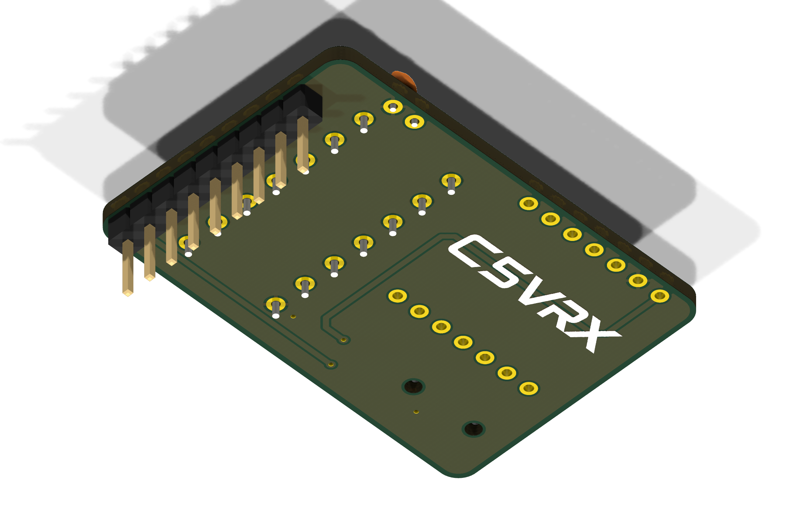
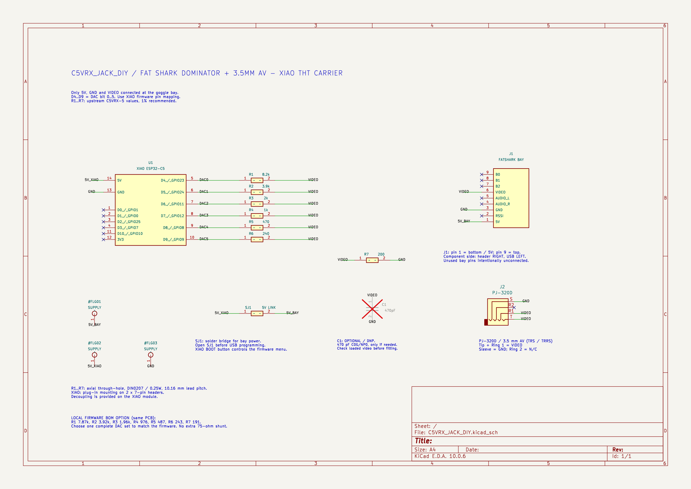

# C5VRX_JACK_DIY Fat Shark Carrier + 3.5mm AV Output (Through-Hole DIY)

  
  

A DIY-friendly KiCad carrier board for the **Seeed Studio XIAO ESP32-C5** running **C5VRX**, designed for standard Fat Shark goggle module bays with an integrated 3.5 mm TRRS AV output jack.

---

## Highlights & Features

- **Standard Module Bay Dimensions:** Exactly **42.51 × 28.80 mm** with 2.0 mm corner radiuses, engineered to fit standard Fat Shark goggle module bays.
- **Easy Through-Hole (THT) Soldering:** The 6-bit R-2R DAC ladder (R1–R7) and optional filter capacitor (C1) use standard axial ¼W resistors (`DIN0207`, 10.16 mm pitch) and a 2.5 mm disc capacitor. Each resistor footprint has clear silkscreen markings with reference and nominal value (`R4 1k`, `R5 470`, `R6 240`, `R1 8.2k`, `R2 3.9k`, `R3 2k`, `R7 200`).
- **Seeed Studio XIAO ESP32-C5 Socket:**
  - Positioned in the upper-left corner on two 7-pin 2.54 mm female headers so the XIAO remains easily removable/reusable.
  - The USB-C port faces left outwards through the board edge for easy firmware updates and serial monitoring.
- **Integrated 3.5mm TRRS AV Jack (J2 / PJ-320D):**
  - Horizontal 4-pole TRRS SMD jack positioned directly beneath the XIAO, facing left.
  - Universal pinout: Tip (T) and Ring 1 (R1) are routed to `/VIDEO`, Sleeve (S) is tied to ground `/GND`.
- **Fat Shark Bay Connector (J1):**
  - Standard 9-pin right-angle male header (2.54 mm pitch) on the right edge.
- **Power Solder Jumper (SJ1):**
  - Located beside the audio jack. Bridge with solder to route the goggle bay 5V rail to the XIAO 5V input.
- **KiCad DRC & ERC Verified:**
  - 0 DRC errors, 0 warnings, 0 unrouted nets.
  - 0 ERC schematic errors or warnings.

---

## Schematic

  

---

## Bill of Materials (BOM)

| Reference | Value | Footprint | Description / Notes |
|:---|:---|:---|:---|
| **U1** | XIAO ESP32-C5 | `C5VRX:XIAO-ESP32-C5-DIP` | Plug-in mounting on 2× 7-pin 2.54mm female pin headers |
| **R1** | 8.2 kΩ | `Resistor_THT:R_Axial_DIN0207_L6.3mm_D2.5mm_P10.16mm_Horizontal` | 1/4W axial through-hole (1% recommended) |
| **R2** | 3.9 kΩ | `Resistor_THT:R_Axial_DIN0207_L6.3mm_D2.5mm_P10.16mm_Horizontal` | 1/4W axial through-hole (1% recommended) |
| **R3** | 2.0 kΩ | `Resistor_THT:R_Axial_DIN0207_L6.3mm_D2.5mm_P10.16mm_Horizontal` | 1/4W axial through-hole (1% recommended) |
| **R4** | 1.0 kΩ | `Resistor_THT:R_Axial_DIN0207_L6.3mm_D2.5mm_P10.16mm_Horizontal` | 1/4W axial through-hole (1% recommended) |
| **R5** | 470 Ω | `Resistor_THT:R_Axial_DIN0207_L6.3mm_D2.5mm_P10.16mm_Horizontal` | 1/4W axial through-hole (1% recommended) |
| **R6** | 240 Ω | `Resistor_THT:R_Axial_DIN0207_L6.3mm_D2.5mm_P10.16mm_Horizontal` | 1/4W axial through-hole (1% recommended) |
| **R7** | 200 Ω | `Resistor_THT:R_Axial_DIN0207_L6.3mm_D2.5mm_P10.16mm_Horizontal` | 1/4W axial through-hole (1% recommended) |
| **J1** | 9-pin Header | `C5VRX:FatShark_Header_1x09` | 9-pin 2.54mm right-angle male header to goggle bay |
| **J2** | PJ-320D | `Connector_Audio:Jack_3.5mm_PJ320D_Horizontal` | 4-pole TRRS SMD 3.5mm jack (Tip & R1: Video, Sleeve: GND) |
| **SJ1** | Solder Bridge | `Jumper:SolderJumper-2_P1.3mm_Open_Pad1.0x1.5mm` | Open jumper; solder to power XIAO from goggle 5V |
| **C1** | 470 pF | `Capacitor_THT:C_Disc_D3.0mm_W1.6mm_P2.50mm` | Optional / DNP; ceramic C0G/NP0 (2.50mm lead pitch) |

---

## Production Files (`exports/`)

- [`exports/C5VRX_JACK_DIY-gerbers.zip`](exports/C5VRX_JACK_DIY-gerbers.zip): Gerber X2 and Excellon drill package ready for PCB fab (JLCPCB, PCBWay, etc.).
- [`exports/gerbers/`](exports/gerbers/): Uncompressed individual Gerber and Excellon drill files.
- [`exports/C5VRX_JACK_DIY-schematic.pdf`](exports/C5VRX_JACK_DIY-schematic.pdf): Vector schematic PDF.
- [`exports/C5VRX_JACK_DIY-fit-check-1to1.pdf`](exports/C5VRX_JACK_DIY-fit-check-1to1.pdf): 1:1 scale printable PDF for mechanical bay fit-checks.
- [`exports/C5VRX_JACK_DIY.step`](exports/C5VRX_JACK_DIY.step) & [`exports/C5VRX_JACK_DIY.glb`](exports/C5VRX_JACK_DIY.glb): 3D CAD models.
