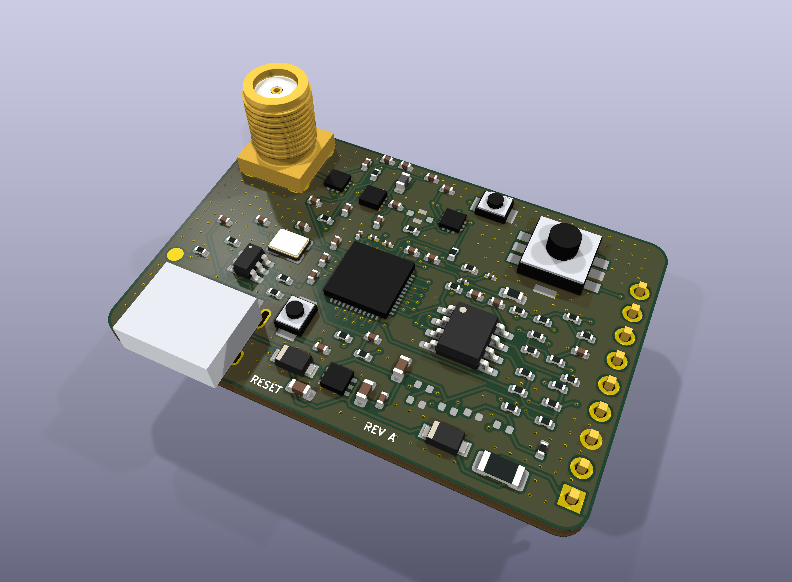
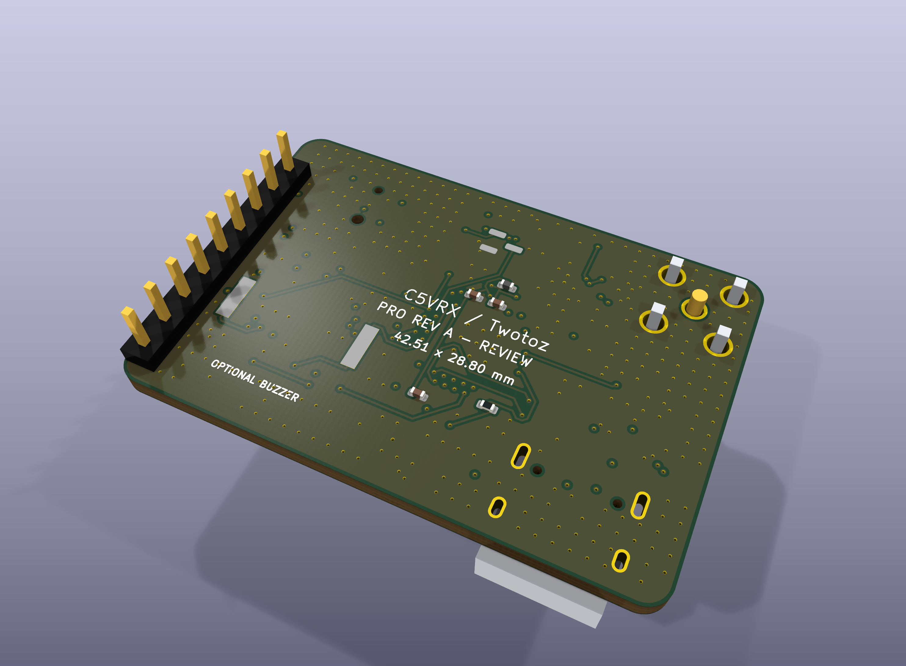

# C5VRX PRO — stand-alone Fat Shark receiver

**Revision A is an engineering review, not an approved PCBWay order.**
This is a component-level ESP32-C5 design in the exact DIY V3 board outline,
with the same nine bay contact positions and functions. No XIAO is used.

| Item | Implementation |
|---|---|
| Outline | 42.51 × 28.80 mm, inherited 2 mm corners, 1.6 mm board |
| Core | ESP32-C5HR2 QFN48, 2 MB in-package PSRAM, 8 MB external flash, 48 MHz crystal |
| Antenna | **Vertical SMA female**, Amphenol 132134; antenna perpendicular to the PCB |
| RF front end | QPL9504, two PE42422 switches, passive default bypass |
| BPF | Optional post-LNA Murata 4.90–5.85 GHz filter, DNP by default |
| Video | Existing six weighted DAC branches and 200 Ω shunt; seventh 15 kΩ branch reserved |
| Controls | One-ADC five-way joystick, separate BOOT and RESET |
| USB | Native USB Serial/JTAG over USB-C, two CC resistors, USBLC6 ESD |
| Power | Diode-isolated USB/bay supplies, bay PTC, exposed-pad 3.3 V LDO |
| Buzzer | Independent GPIO and optional piezo/MOSFET/discharge resistor; DNP |

The USB-C connector replaces the DIY board's large TRRS jack. CVBS remains
on bay pin 6 and TP1. There are **no GPIO-selection solder bridges**: the
joystick, optional buzzer and reserved seventh DAC branch have separate pins.

## Review files

- [Component selection](COMPONENTS.md) and [complete assembly BOM](BOM.csv).
- [KiCad project](C5VRX_PRO.kicad_pro), [PCB](C5VRX_PRO.kicad_pcb),
  [seven-page schematic PDF](exports/C5VRX_PRO-schematic.pdf).
- Mechanical assembly: [STEP](exports/C5VRX_PRO.step), [GLB](exports/C5VRX_PRO.glb).
- [3000 × 2200 render gallery](exports/renders/) and [render ZIP](exports/C5VRX_PRO-renders.zip).
- Actual [DRC/parity report](validation/drc.json), [ERC report](validation/erc.json),
  [design audit](validation/design-audit.json).
- [PCBWay fabrication and bring-up requirements](FABRICATION.md).

The gallery and assembly models are exported from this PCB, not generated
product illustrations. DNP components are absent from the default assembly.
The custom STEP models are **parametric package envelopes**, with illustrative
SMA thread rings and simplified USB/joystick bodies. They are not certified
supplier CAD or proof of enclosure clearance. The board outline and bay pads,
in contrast, are compared directly against the existing DIY V3 CAD.

## GPIO and firmware contract

| Role | GPIOs / behavior |
|---|---|
| Q nibble | 1, 0, 25, 2, low to high |
| I nibble | 27, 5, 3, 4, low to high |
| Existing DAC bits 0–5 | 23, 24, 11, 12, 8, 9 |
| Future seventh new LSB | 10 through R8, DNP |
| Joystick | **6 / ADC1_CH5**, 10 kΩ pull-up and 22 kΩ fixed pull-down |
| Optional buzzer | **7**, MOSFET gate; external pull-down |
| RF path select | **26**; low = passive bypass, high = LNA path |
| Native USB | 13 = D−, 14 = D+ |
| BOOT | 28, active low; 10 kΩ pull-up |
| RESET | CHIP_PU, active low; 10 kΩ / 1 µF startup RC |

These are real ESP32-C5 numbers, not XIAO silk labels. IQ is internal GPIO
matrix routing: those pins intentionally have no external signal traces.
GPIO27 retains a boot pull-up so BOOT-low selects USB download rather than
the USB-disabled download mode. Flash and PSRAM pins are never user IO.

The current C5VRX-5 pin map and six-bit video interface are retained. This PR
does **not** integrate a joystick driver, buzzer driver, RF switching policy
or seven-bit demodulator into the flight firmware. Existing firmware leaves
GPIO26 pulled low and therefore uses the passive RF path. Do not assume the
LNA is active merely because it is fitted. This hardware needs its own
board-specific firmware integration and board validation before production.

Joystick nominal levels at 3.3 V are approximately 0.007 V (press), 0.288 V
(up), 0.550 V (down), 0.922 V (left), 1.345 V (right), 2.269 V (released).
Calibrate real ADC thresholds with attenuation enabled, filter/debounce on the
slow control task, reject unknown levels, and support one direction at a time.
Joystick polling must never pace PARLIO or RF samples. Button directions
must be confirmed against the switch orientation on the assembled board.

The RF path must stay bypassed before any PHY initialization, calibration,
retune, restore or shutdown that might transmit. Enable the LNA only after
receive-only state is established; return to bypass on every failure. Audit
all vendor PHY call paths rather than adding an unconditional enable after
boot. External gain changes invalidate receiver noise/gain/DC calibration
provenance. Bypass/LNA switching needs explicit measured state transitions.

Seventh-bit operation requires firmware that emits seven meaningful bits,
shifts the existing six branches up one place, and remaps their significance.
Fitting R8 alone does not add resolution. No sensitivity/range improvement
is claimed from the wider DAC or the LNA's headline specifications.

## Evidence and remaining engineering

The digital checks cover pad/net correspondence, board mechanics, pin roles,
basic DAC/joystick circuit calculations, KiCad clearance/connectivity and
schematic parity. Seven ERC singleton-label warnings document the internal IQ
pins; the symbols use passive pin types, so ERC does not prove power-driver
or MCU pin-function correctness. The pin tables still require independent
datasheet review.

Routing includes a general-purpose routing pass and subsequent ground/width
cleanup. **The RF traces are not yet an approved 50 Ω layout, and USB is not
yet an approved 90 Ω differential route.** A passing connectivity DRC does
not change this. RF layer transitions, launch/matching, branch stubs, ground
returns, power necks and differential routing require manual optimization
against an agreed PCBWay stackup. No order-ready Gerber bundle is supplied
while those release blockers remain. See [FABRICATION.md](FABRICATION.md).

No board has been fabricated, assembled, flashed, measured or fitted in a
goggle bay. Final BOM sourcing, exact supplier footprints, RF performance,
LDO temperature, boot reliability, USB compliance and loaded video quality
remain unqualified. The draft PR is the place to review this first hardware
revision; it is not a production sign-off.

## Rebuilding

Requires KiCad 10 (tested CLI/API 10.0.6), Python 3.13 with CadQuery 2.8.0,
and optionally Freerouting 2.5.0 / Java 25. `KICAD_INSTALL` and `KICAD_CLI`
override the Windows defaults in the tools.

1. `python tools/build_models.py`
2. Run `tools/build_board.py` with KiCad's Python. This intentionally resets routing.
3. `python tools/build_schematic.py`; export the XML netlist to `validation/schematic.xml`.
4. Run `tools/route_board.py prepare` with KiCad Python, route the DSN, then
   `tools/route_board.py import`. The saved SES is the routing checkpoint.
5. Run `tools/finish_board.py` with KiCad Python, then KiCad DRC with
   `--schematic-parity` and ERC. Run `tools/check_design.py` with KiCad Python.
6. `python tools/export_review.py` exports the PDF, assembly and gallery.

Routing environment used: `FREEROUTING__ROUTER__AUTOMATIC_NECKDOWN=false`,
`FREEROUTING__ROUTER__FANOUT__MAX_PASSES=3`, CLI `-mp 30 -mt 4`.
The final pass enforces 0.127 mm minimum traces and removes external IQ stubs.

## Attribution

This design extends **C5VRX by Twotoz and the C5VRX contributors**, especially
the DIY V3 mechanical interface and passive DAC, at base commit
`e0f49b5`. [Canonical source](https://github.com/Twotoz/C5VRX);
[official website and Discord invite](https://twotoz.github.io/C5VRX/).
Covered project material remains under [GPL-3.0-only](../../LICENSE);
separate [branding terms](../../assets/BRANDING.md) remain applicable.
Vendor facts and footprint/model provenance are in [SOURCES.md](SOURCES.md).
